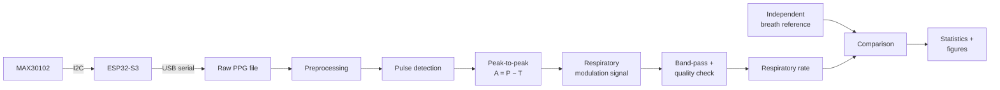
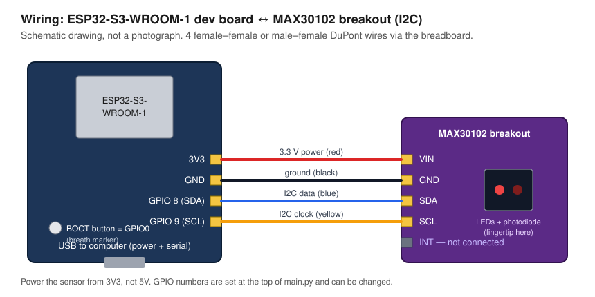
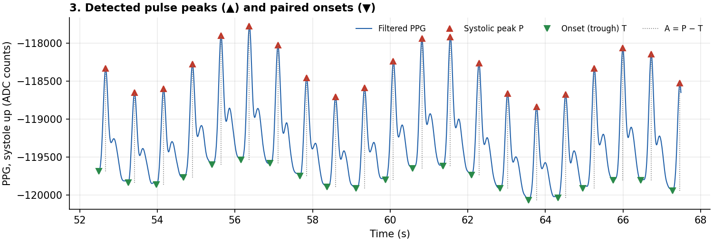
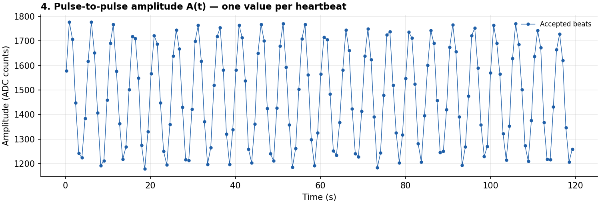
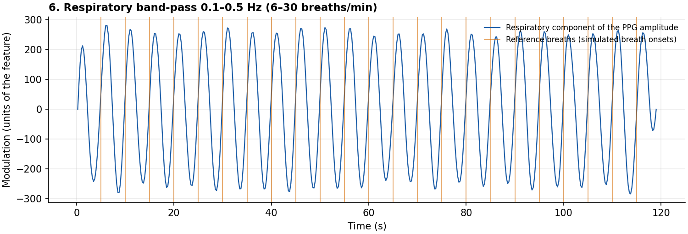
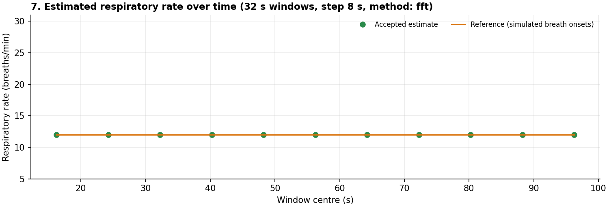

# PPG Respiratory Estimator

**Extract breathing rate from a pulse sensor, without a breathing sensor.**

> Research and teaching project. Not a medical device; no clinical validation.

| | |
|-|-|
| **Software** | Complete, 173 automated tests passing |
| **Verification on simulated signals** | Done ([report](results/synthetic_verification/report.md)) |
| **Hardware (ESP32-S3 + MAX30102)** | Assembled by the project owner; the Arduino sketch streamed live data in the Arduino IDE (screenshot seen in the session, not stored here); no photographs or ground-truth recordings in the repository yet |
| **Experiment on people** | Not yet performed, so **the research question is still open** |

## 1. Project Title

PPG Respiratory Estimator: Extract Breathing Rate Without Extra Sensors

## 2. Project Overview

A photoplethysmogram (PPG) is the optical pulse signal measured by shining
light into a fingertip. Breathing subtly changes that signal. This project
measures the height of every pulse wave (peak-to-peak amplitude), tracks how
that height rises and falls over time, and reads the breathing rate from that
rhythm. It then compares the result with breaths counted independently, to
find out how far such an estimate can be trusted.

The repository contains the acquisition firmware, a Python analysis package,
a statistical evaluation against ground truth, tests, and the experimental
protocol.

## 3. Research Question

> **How well does optical peak-to-peak modulation correlate with actual breath counts?**

"Correlate" is taken in the wider sense of *agree*: besides correlation
coefficients the project reports error (MAE, RMSE), bias and Bland–Altman
limits of agreement, because two measurements can correlate strongly and
still disagree.

## 4. Objectives

1. Acquire raw PPG from a MAX30102 with an ESP32-S3 at a known sampling rate.
2. Detect individual pulse waves and extract `A_i = P_i − T_i` for each.
3. Turn the amplitude series into a respiratory signal and estimate the
   breathing rate with four independent methods.
4. Judge signal quality and withhold estimates that are not supported by the
   signal.
5. Compare with an independent breath reference and quantify agreement.
6. Document limitations and make every step reproducible.

## 5. Scientific Background

Breathing modulates the PPG in three ways [3, 4]:

- **Amplitude modulation (AM)** – pulse height changes as intrathoracic
  pressure alters stroke volume. *This is the mechanism under study.*
- **Baseline wander (BW)** – the baseline shifts with venous return.
- **Frequency modulation (FM)** – heart rate speeds up on inspiration.

Published algorithms extract one or more of these and estimate the rate in
the time or frequency domain [1, 2, 6, 10, 11]. Their performance varies
widely between people and conditions, and no single modulation is reliably
present in everyone [2, 3]. The project isolates AM, implements BW and FM
only for side-by-side comparison, and never blends them into the primary
estimate.

Full derivation, signal model and justification of each parameter:
[docs/methodology.md](docs/methodology.md).

## 6. System Architecture



One Python package, one module per stage, each with a typed input and output.
Module table, interfaces and the detailed pipeline diagram:
[docs/architecture.md](docs/architecture.md).

## 7. Hardware Requirements

| Part | Role |
|------|------|
| ESP32-S3-WROOM-1 development board | Controller, USB serial |
| MAX30102 breakout | PPG sensor (I2C) |
| Breadboard, DuPont wires, USB data cable | Assembly |
| 0.96" SSD1306 OLED, 128×64, I2C (optional) | Live heart monitor (heart rate + pulse waveform), wired in parallel with the sensor |

| MAX30102 | ESP32-S3 |
|----------|----------|
| VIN | 3V3 |
| GND | GND |
| SDA | GPIO 8 |
| SCL | GPIO 9 |



The board runs an Arduino sketch
([hardware/firmware/arduino_monitor/](hardware/firmware/arduino_monitor/)) that
streams the raw data to the computer and shows a live heart monitor (heart
rate and pulse waveform) on the optional OLED. Firmware description,
data-stream format and bring-up checklist:
[hardware/README.md](hardware/README.md). Step-by-step guide in Russian, from
wiring to a recorded measurement:
[docs/arduino_guide_ru.md](docs/arduino_guide_ru.md). No photographs of the
device are in the repository yet and none are faked. No 3D-printed parts are
used (explained in the hardware README).

The software also runs without any hardware on recorded files.

## 8. Software Requirements

- Python ≥ 3.9 (developed on 3.14)
- numpy, scipy, pandas, matplotlib, pyyaml, pyserial; pytest for the tests
- For the board: [Arduino IDE](https://www.arduino.cc/en/software) 2.x with the
  *esp32 by Espressif Systems* board package and the libraries *SparkFun
  MAX3010x Pulse and Proximity Sensor Library*, *Adafruit SSD1306* and
  *Adafruit GFX Library*

## 9. Installation

```bash
git clone https://github.com/capitalisming/heart-beat.git
cd heart-beat
python3 -m venv .venv
source .venv/bin/activate
pip install -e ".[dev]"
python -m pytest
```

Expected last line: `173 passed` (the C++ detector tests are skipped if no C++ compiler is installed).

## 10. Usage

**Try it without hardware** on a simulated recording:

```bash
python scripts/run_estimation.py data/sample/SYNTHETIC_rr12.csv --reference markers
```

```
Recording : data/sample/SYNTHETIC_rr12.csv  (90.0 s, fs = 100.00 Hz)
Pulses    : 102 detected, heart rate 68.2 bpm
Windows   : 8 of 8 accepted
RESPIRATORY RATE (median of accepted windows): 12.0 breaths/min [range 12.0-12.0]
Signal quality index (median): 100 / 100  (a heuristic, not a probability)
Reference (button marker): 12.0 breaths/min
```

Figures of every processing stage, `windows.csv` and `summary.json` are
written to `results/runs/<name>/`.

**Record from the device and analyse:**

```bash
python scripts/record_serial.py --list
```

```bash
python scripts/record_serial.py --port <port> --duration 180 --participant P01 --session S1 --condition rest --analyze
```

**Evaluate a whole study against ground truth:**

```bash
python scripts/run_evaluation.py data/manifest.csv --outdir results/study --recording-figures
```

**Re-run the synthetic verification:**

```bash
python scripts/synthetic_verification.py
```

Useful options: `--feature am|am_detrended|bw|fm` to analyse another
modulation, `--channel ir|red`, `--config <yaml>`. A poor signal produces a
status and a reason instead of a number:

```
STATUS: LOW QUALITY - no respiratory rate is reported
  reason  : irregular pulse intervals [11 window(s)]
  advice  : Repeat the measurement: keep the finger still, with light steady pressure on the sensor.
```

From Python:

```python
from ppg_resp.acquisition import load_recording
from ppg_resp.config import load_settings
from ppg_resp.pipeline import run_pipeline

result = run_pipeline(load_recording("data/raw/P01_S1_rest.csv"), load_settings("config/settings.yaml"))
print(result.summary())
```

## 11. Data Format

**PPG recording** (CSV or TXT; `#` lines are comments). Firmware format:

```csv
sample_index,device_us,ir,red,marker
0,2011934,118211,95310,0
```

Also accepted: a time column (`timestamp_s`, `time_s`, `t`, or
`timestamp_ms`) with a value column (`ppg`, `pleth`, `ir`, `red`, `value`),
or headerless one-column (values; pass `--fs`) and two-column (seconds,
value) files. Optional `<name>.meta.json` next to the file holds participant
code, session, condition and notes.

**Breath reference**, one of:

| Type | Content |
|------|---------|
| `markers` | The `marker` column of the recording (button press per breath) |
| `events` | File with one breath time in seconds per line, column `breath_time_s` |
| `waveform` | File with `time_s` and `resp` columns from an independent sensor |
| `count` | Total breaths and the duration they were counted over |

**Study manifest**: one row per recording; example in
[data/sample/manifest.csv](data/sample/manifest.csv), columns explained in
[docs/experiment_protocol.md](docs/experiment_protocol.md#6-manifest).

**Outputs**: `windows.csv` has one row per 32 s window with status, accepted
rate, withheld candidate, all four method estimates, SQI and its components.

## 12. Signal Processing Pipeline

1. **Validate** timestamps and sampling rate; mark missing and saturated
   samples; bridge only gaps ≤ 0.3 s.
2. **Clean**: orient the signal (systole up), remove isolated spikes.
3. **Filter** (zero-phase Butterworth): low-pass 8 Hz for measuring, band-pass
   0.5–4 Hz for detecting.
4. **Detect pulses** with a prominence threshold relative to the local
   signal, so settings do not depend on sensor gain.
5. **Peak-to-peak amplitude** `A_i = P_i − T_i`, each peak paired with its own
   preceding trough; implausible beats rejected.
6. **Respiratory signal**: interpolate the per-beat series to 4 Hz, no
   extrapolation, long gaps left open.
7. **Band-pass** 0.1–0.5 Hz (6–30 breaths/min, configurable).
8. **Estimate** in 32 s windows: periodogram peak (primary), Welch PSD,
   autocorrelation, peak counting. `RR = 60 · f_resp`.
9. **Quality gate**: SQI 0–100 → `OK`, `LOW_QUALITY` or `INSUFFICIENT_DATA`.

Example output of the stages (simulated signal):

| | |
|-|-|
|  |  |
|  |  |

## 13. Experimental Methodology

Healthy adult volunteers, seated, fingertip on the sensor. Six conditions of
180 s: quiet breathing, paced at 10, 15 and 20 breaths/min, and optionally
supine and after repositioning the finger. An observer presses the board's
button at every inhalation; the presses are recorded in the same stream as
the PPG, which synchronises them by construction. A separate tally count
backs up the button. No breath-holding or forced breathing.

Full protocol with safety, anonymisation, synchronisation and pre-specified
analysis: [docs/experiment_protocol.md](docs/experiment_protocol.md).

## 14. Evaluation Metrics

With `error = estimate − reference` in breaths/min:

| Metric | Shows |
|--------|-------|
| MAE, RMSE | Typical size of the error |
| Bias, SD of error | Systematic offset and scatter |
| Bland–Altman limits of agreement | Range containing ~95 % of differences; plot reveals rate-dependent error |
| Pearson r, Spearman ρ | Association only, reported with the range of rates |
| Accepted fraction | How much data the quality gate kept |

Overlapping windows of one recording are not treated as independent: the
recording is the unit of inference, clustered by participant, and confidence
intervals are only given with at least 6 participants. Details:
[docs/methodology.md §6](docs/methodology.md#6-statistics).

## 15. Results

### Real recordings

**None yet.** No recording with an independent breath reference has been
analysed, so there is no answer to the research question in this repository.
When recordings exist, `scripts/run_evaluation.py` produces the report,
tables and figures for this section.

### Verification on simulated signals

These numbers show that the software recovers a known rate from a model
signal. **They are not the accuracy of the method on people.**

| Check | Result |
|-------|--------|
| 8 simulated participants × 5 rates (8–24 /min), 120 s each, 40 recordings | Recording-level MAE 0.003 breaths/min, bias 0.000; 440 of 440 windows accepted |
| Pulses with no respiratory modulation (264 windows) | 4.9 % wrongly accepted by the quality gate |
| Noise SD 0.10 of pulse height (10 % modulation) | 100 % accepted, MAE 0.11 |
| Noise SD 0.20 | 72 % accepted, MAE 0.22 |
| Noise SD 0.40 | 11 % accepted, MAE 0.50 |
| Breathing faster than half the heart rate | Aliases to a wrong rate with a high SQI (known limitation, kept as a test) |

The near-zero error reflects a simulator with a perfectly steady breathing
rate and white noise. Real signals are harder. Full report:
[results/synthetic_verification/report.md](results/synthetic_verification/report.md).

## 16. Limitations

- No recordings with ground truth yet.
- Amplitude modulation is weak or absent in some people and conditions.
- Peak-to-peak amplitude also picks up baseline wander.
- Breathing above half the heart rate is aliased and undetectable as such.
- Fixed 6–30 breaths/min band; steady rate assumed within 32 s.
- Sensitive to finger motion and contact pressure.
- The quality threshold is calibrated on simulations only.
- A button-press reference has reaction-time jitter and can miss breaths.

Complete list: [docs/limitations.md](docs/limitations.md).

## 17. Reproducibility

- All parameters live in [config/settings.yaml](config/settings.yaml); the
  configuration is validated before any data is processed.
- Raw recordings are never modified; every result is recomputed from them.
- Simulations use fixed random seeds; `scripts/synthetic_verification.py`
  regenerates `results/synthetic_verification/` and `data/sample/`.
- `python -m pytest` runs 173 tests covering each module, the on-device beat
  detector (compiled from the sketch's own header), the serial stream format
  against the sketch, the listed edge
  cases (empty files, gaps, irregular timestamps, wrong sampling rate,
  artifacts, no pulse, no modulation) and the statistics.
- The experiment is specified in advance in
  [docs/experiment_protocol.md](docs/experiment_protocol.md).

## 18. Future Improvements

1. Complete the bring-up checklist on the built device and add photographs.
2. Run the experiment and fill in the Results section.
3. Calibrate the SQI threshold on real data, with separate tuning and test
   participants.
4. Test on the public BIDMC dataset (`scripts/prepare_bidmc.py`; prepared,
   not run) as an independent check on real PPG.
5. Add a respiratory belt as a second, automatic reference.
6. A fingertip cradle to stabilise contact pressure.
7. Compare AM with BW and FM on the same recordings, and only then consider
   fusing them [1].

## 19. Contributors

- Project author: *add your name before submission.*
- Code and documentation were written with the assistance of Claude
  (Anthropic), as recorded in the commit history.

## 20. References

1. Karlen W, Raman S, Ansermino JM, Dumont GA. Multiparameter respiratory rate estimation from the photoplethysmogram. *IEEE Trans Biomed Eng.* 2013;60(7):1946–1953. doi:10.1109/TBME.2013.2246160
2. Charlton PH, Bonnici T, Tarassenko L, Clifton DA, Beale R, Watkinson PJ. An assessment of algorithms to estimate respiratory rate from the electrocardiogram and photoplethysmogram. *Physiol Meas.* 2016;37(4):610–626. doi:10.1088/0967-3334/37/4/610
3. Charlton PH, Birrenkott DA, Bonnici T, et al. Breathing rate estimation from the electrocardiogram and photoplethysmogram: a review. *IEEE Rev Biomed Eng.* 2018;11:2–20. doi:10.1109/RBME.2017.2763681
4. Meredith DJ, Clifton D, Charlton P, Brooks J, Pugh CW, Tarassenko L. Photoplethysmographic derivation of respiratory rate: a review of relevant physiology. *J Med Eng Technol.* 2012;36(1):1–7. doi:10.3109/03091902.2011.638965
5. Allen J. Photoplethysmography and its application in clinical physiological measurement. *Physiol Meas.* 2007;28(3):R1–R39. doi:10.1088/0967-3334/28/3/R01
6. Pimentel MAF, Johnson AEW, Charlton PH, et al. Toward a robust estimation of respiratory rate from pulse oximeters. *IEEE Trans Biomed Eng.* 2017;64(8):1914–1923. doi:10.1109/TBME.2016.2613124
7. Bland JM, Altman DG. Statistical methods for assessing agreement between two methods of clinical measurement. *Lancet.* 1986;327(8476):307–310. doi:10.1016/S0140-6736(86)90837-8
8. Bland JM, Altman DG. Agreement between methods of measurement with multiple observations per individual. *J Biopharm Stat.* 2007;17(4):571–582. doi:10.1080/10543400701329422
9. Elgendi M, Norton I, Brearley M, Abbott D, Schuurmans D. Systolic peak detection in acceleration photoplethysmograms measured from emergency responders in tropical conditions. *PLoS ONE.* 2013;8(10):e76585. doi:10.1371/journal.pone.0076585
10. Nilsson LM. Respiration signals from photoplethysmography. *Anesth Analg.* 2013;117(4):859–865. doi:10.1213/ANE.0b013e31828098b2
11. Addison PS, Watson JN, Mestek ML, Mecca RS. Developing an algorithm for pulse oximetry derived respiratory rate (RRoxi): a healthy volunteer study. *J Clin Monit Comput.* 2012;26(1):45–51. doi:10.1007/s10877-011-9332-y
12. Welch PD. The use of fast Fourier transform for the estimation of power spectra: a method based on time averaging over short, modified periodograms. *IEEE Trans Audio Electroacoust.* 1967;15(2):70–73. doi:10.1109/TAU.1967.1161901

Sensor and tools: Maxim Integrated, *MAX30102 High-Sensitivity Pulse
Oximeter and Heart-Rate Sensor for Wearable Health* (datasheet); Arduino IDE,
<https://www.arduino.cc/en/software>; SparkFun MAX3010x Sensor Library,
<https://github.com/sparkfun/SparkFun_MAX3010x_Sensor_Library>; Adafruit SSD1306,
<https://github.com/adafruit/Adafruit_SSD1306>; Adafruit GFX,
<https://github.com/adafruit/Adafruit-GFX-Library>.
Optional dataset: BIDMC PPG and Respiration Dataset, <https://physionet.org/content/bidmc/> [6].
