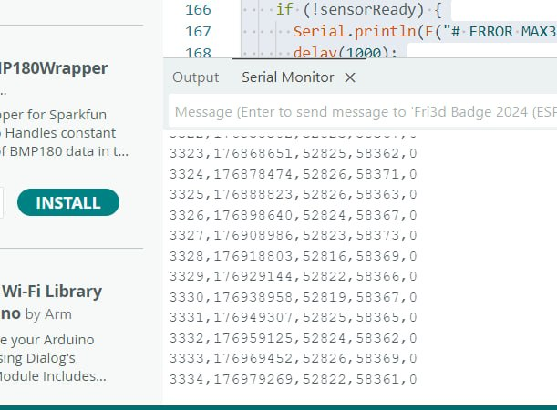

# PPG Respiratory Estimator

Estimating breathing rate from a pulse sensor, without a separate breathing sensor.
Hardware: ESP32-S3 and MAX30102, processing in Python.

## About the project

The MAX30102 shines red and infrared light into a finger and measures how much
comes back. This is a photoplethysmogram (PPG): every pulse wave is visible in
it. Breathing changes the signal slightly, including the height of the pulse
waves. If we measure the height of every wave and watch how it rises and falls
over time, we can get the breathing rate from that rhythm.

What the program does:

1. The board reads the sensor (100 samples per second) and sends the data to the computer.
2. Python filters the signal and finds the pulse waves.
3. For each wave it computes the peak-to-peak amplitude `A = P - T` (the peak minus
   the trough before it).
4. The series of `A` values is resampled to a uniform grid and filtered to the
   breathing band (0.1-0.5 Hz, i.e. 6-30 breaths per minute).
5. The breathing rate is the main spectral peak in a 32 s window.
6. The result is compared with an independent count of breaths.

If the signal is poor, the program does not print a number but a reason
(`LOW QUALITY` or `INSUFFICIENT DATA`).

The board can also drive a screen: with a 0.96" OLED connected it shows the heart
rate and a scrolling pulse waveform, like a hospital monitor. That heart rate is
computed in a simplified way and is only for display.

## Research question

**How well does the peak-to-peak modulation of the pulse waves agree with the
actual number of breaths?**

We judge agreement not only by correlation but also by error (MAE, RMSE), bias and
a Bland-Altman plot: correlation can be high while the numbers are still wrong.

Reference for breathing: a helper presses the BOOT button on the board at the start
of every inhalation. The presses are recorded in the same stream as the signal, so
no separate synchronisation is needed. Full measurement protocol:
[docs/experiment_protocol.md](docs/experiment_protocol.md).

**Status.** There are no measurements on people with a reference yet, so the question
is not answered. On simulated signals the program finds the set breathing rate, but
that checks the code, not the accuracy of the method. The version of the sketch with
the OLED screen has not been confirmed on the board yet (the heart-rate detector was
only tested on a computer). Limitations: [docs/limitations.md](docs/limitations.md).

## What you need

- a board with an ESP32-S3
- a MAX30102 sensor
- a 0.96" SSD1306 OLED, 128x64, I2C (optional)
- breadboard, jumper wires, a USB cable that carries data
- Windows 10 or 11, Python, Arduino IDE

Wiring (the OLED is connected in parallel with the sensor, to the same GPIO 8 and 9):

| MAX30102 | OLED | ESP32-S3 |
|----------|------|----------|
| VIN | VCC | 3V3 (not 5V) |
| GND | GND | GND |
| SDA | SDA | GPIO 8 |
| SCL | SCL | GPIO 9 |

Diagram: [hardware/wiring_diagram/wiring.svg](hardware/wiring_diagram/wiring.svg).
If your board has I2C on other pins, change `PIN_I2C_SDA` and `PIN_I2C_SCL` at the
top of the sketch.

## Installation on Windows

1. Install Python 3.12 or 3.13 from [python.org](https://www.python.org/downloads/windows/).
   In the installer tick **Add python.exe to PATH**.
2. Get the project: on the GitHub page press **Code, Download ZIP** and extract it.
   Or `git clone https://github.com/capitalisming/heart-beat.git`.
3. Double-click `install_windows.bat`.

The installer creates a `.venv` folder, installs the packages (internet needed),
and runs the tests and a demo on a simulated signal. On Windows some tests are
skipped (they need a C++ compiler); that is normal.

The installer has not been tested on a real Windows machine. If it does not work,
do the same by hand in PowerShell, in the project folder:

```powershell
py -3 -m venv .venv
.\.venv\Scripts\python -m pip install -e ".[dev]"
.\.venv\Scripts\python -m pytest
```

After installing, run scripts through `ppg.bat` (in PowerShell: `.\ppg`):

```
ppg scripts\run_estimation.py data\sample\SYNTHETIC_rr12.csv --reference markers
```

You should get `RESPIRATORY RATE ... 12.0 breaths/min`. The file in `data\sample`
is simulated.

macOS and Linux: `python3 -m venv .venv`, `source .venv/bin/activate`,
`pip install -e ".[dev]"`, then `python scripts/...`.

## Firmware in Arduino IDE

1. Install [Arduino IDE 2.x](https://www.arduino.cc/en/software).
2. **File, Preferences**, in *Additional boards manager URLs* add
   `https://espressif.github.io/arduino-esp32/package_esp32_index.json`.
3. **Tools, Board, Boards Manager**: install *esp32 by Espressif Systems*.
4. **Sketch, Include Library, Manage Libraries**: install
   *SparkFun MAX3010x Pulse and Proximity Sensor Library*, *Adafruit SSD1306* and
   *Adafruit GFX Library*.
5. Open `hardware/firmware/arduino_monitor/arduino_monitor.ino`
   (`BeatDetector.h` must be next to it).
6. In **Tools** select the board (for example *ESP32S3 Dev Module*) and the port.
   If the Serial Monitor stays empty afterwards, enable **USB CDC On Boot**.
7. Press Upload. If it does not start: hold BOOT, press RESET, release BOOT.
8. **Tools, Serial Monitor**, speed 115200.

Put a finger on the sensor. The screen shows the heart rate and the waveform, and
the serial monitor shows the data. If compilation fails, first check that all three
libraries are installed.

Settings at the top of the sketch:

- `SERIAL_MODE`: 0 is data for recording (default), 1 is labelled values
  (`IR=... RED=... BPM=...`), 2 is the format for the Serial Plotter
- `FINGER_ON` and `FINGER_OFF`: thresholds for detecting a finger; set them from
  the `IR` values without and with a finger (mode 1)
- `LED_CURRENT`: LED current, increase it if the pulse is weak
- `OLED_ADDRESS`: 0x3C, some displays use 0x3D

A detailed guide in Russian with a troubleshooting table:
[docs/arduino_guide_ru.md](docs/arduino_guide_ru.md).

## Recording and analysis

Before recording, close the Serial Monitor (only one program can use the port) and
set `SERIAL_MODE 0`. The port number is shown in Arduino IDE or in Device Manager
(Ports, COM & LPT):

```
ppg scripts\record_serial.py --list
ppg scripts\record_serial.py --port COM5 --duration 180 --participant P01 --session S1 --condition rest --analyze
```

During the recording the helper presses BOOT at the start of every inhalation.
Afterwards the program prints the breathing rate, the heart rate and the reference
from the presses, and saves figures of every stage to `results\runs\...`.

For a series of recordings write `data\manifest.csv` (example: `data\sample\manifest.csv`):

```
ppg scripts\run_evaluation.py data\manifest.csv --outdir results\study --recording-figures
```

`results\study\report.md` will contain the report: MAE, RMSE, bias, correlations and
the Bland-Altman plot.

### Data format

The board outputs CSV, 100 lines per second:

```
sample_index,device_us,ir,red,marker
3334,176979269,52822,58361,0
```

- `sample_index` is the sample number (a gap means lost data)
- `device_us` is the board time in microseconds; the program uses it to compute the
  real sampling rate
- `ir`, `red` are the raw signals of the two LEDs
- `marker` is 1 after BOOT was pressed (breath mark)

Lines starting with `#` are messages from the board; the recorder skips them.

## Screenshots

Output of the board in the Serial Monitor (a real screenshot from our board):



Here `ir` hardly changes (about 10 counts out of 52 000), so there is no pulse wave
in this fragment: the finger needs good contact with the sensor.

The next pictures are made from a **simulated** signal (120 s, breathing 12 per
minute); they are not a measurement of a person.

Detected pulse waves: peaks P, troughs T and the amplitude A = P - T.


The breathing component obtained from the wave amplitude, with the breath marks:


There are no photos of the assembled device in the repository yet.

## References

1. Karlen W. et al. Multiparameter respiratory rate estimation from the photoplethysmogram. IEEE Trans Biomed Eng, 2013. doi:10.1109/TBME.2013.2246160
2. Charlton P.H. et al. An assessment of algorithms to estimate respiratory rate from the electrocardiogram and photoplethysmogram. Physiol Meas, 2016. doi:10.1088/0967-3334/37/4/610
3. Charlton P.H. et al. Breathing rate estimation from the electrocardiogram and photoplethysmogram: a review. IEEE Rev Biomed Eng, 2018. doi:10.1109/RBME.2017.2763681
4. Meredith D.J. et al. Photoplethysmographic derivation of respiratory rate: a review of relevant physiology. J Med Eng Technol, 2012. doi:10.3109/03091902.2011.638965
5. Allen J. Photoplethysmography and its application in clinical physiological measurement. Physiol Meas, 2007. doi:10.1088/0967-3334/28/3/R01
6. Pimentel M.A.F. et al. Toward a robust estimation of respiratory rate from pulse oximeters. IEEE Trans Biomed Eng, 2017. doi:10.1109/TBME.2016.2613124
7. Bland J.M., Altman D.G. Statistical methods for assessing agreement between two methods of clinical measurement. Lancet, 1986. doi:10.1016/S0140-6736(86)90837-8
8. Bland J.M., Altman D.G. Agreement between methods of measurement with multiple observations per individual. J Biopharm Stat, 2007. doi:10.1080/10543400701329422
9. Elgendi M. et al. Systolic peak detection in acceleration photoplethysmograms measured from emergency responders in tropical conditions. PLoS ONE, 2013. doi:10.1371/journal.pone.0076585
10. Nilsson L.M. Respiration signals from photoplethysmography. Anesth Analg, 2013. doi:10.1213/ANE.0b013e31828098b2
11. Addison P.S. et al. Developing an algorithm for pulse oximetry derived respiratory rate (RRoxi): a healthy volunteer study. J Clin Monit Comput, 2012. doi:10.1007/s10877-011-9332-y
12. Welch P.D. The use of fast Fourier transform for the estimation of power spectra. IEEE Trans Audio Electroacoust, 1967. doi:10.1109/TAU.1967.1161901

Hardware and libraries: MAX30102 datasheet (Maxim Integrated),
[SparkFun MAX3010x library](https://github.com/sparkfun/SparkFun_MAX3010x_Sensor_Library),
[Adafruit SSD1306](https://github.com/adafruit/Adafruit_SSD1306),
[Adafruit GFX](https://github.com/adafruit/Adafruit-GFX-Library).

A student project, not a medical device.
