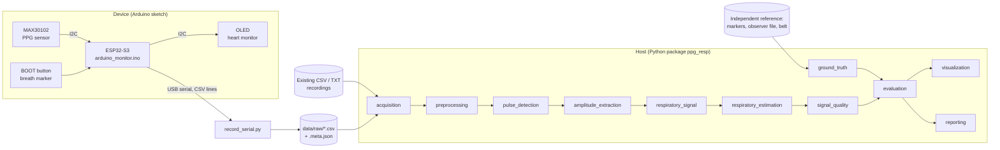
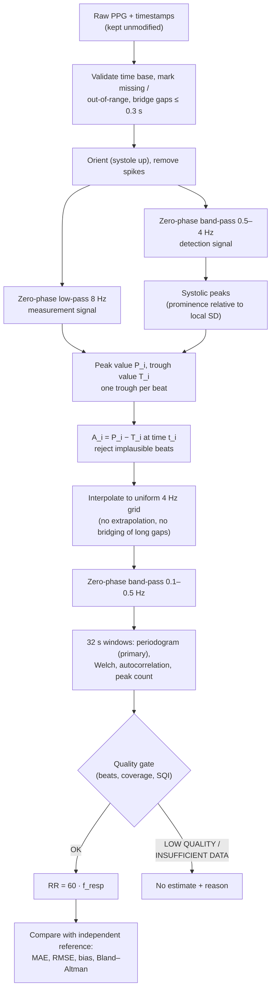

# Architecture

A single Python package with one module per processing stage. No services, no
database: a research pipeline is easiest to audit when a recording is a file,
a stage is a function, and every intermediate result is an object you can plot.

## System overview



Two usage scenarios share everything after `acquisition`:

- **Recorded data**: `load_recording()` reads CSV/TXT.
- **New data**: `record_serial()` writes the stream to a raw file, which is
  then loaded the same way. Analysis always runs from the stored raw file, so
  any result can be reproduced later.

## Signal-processing pipeline



## Modules and interfaces

Each stage takes the previous stage's dataclass and returns its own. Nothing
is passed through globals; all tunable numbers come from `Settings`.

| # | Component | Module | Input → output | Responsibility |
|---|-----------|--------|----------------|----------------|
| 1 | Data acquisition | `acquisition.py` | file / serial port → `PPGRecording` | Parse formats, preserve raw values and timestamps, recover the true sampling rate, extract breath markers |
| 2 | Preprocessing | `preprocessing.py` | `PPGRecording` → `PreprocessedPPG` | Validation, cleaning, zero-phase filters, bad-segment mask, report of everything found |
| 3 | Pulse detection | `pulse_detection.py` | `PreprocessedPPG` → `PulseDetection` | Systolic peaks, paired troughs, interval plausibility |
| 4 | Peak-to-peak extraction | `amplitude_extraction.py` | `PulseDetection` → `BeatFeatures` | `A_i = P_i − T_i`, pairing check, beat rejection; BW and FM series for comparison |
| 5 | Respiratory signal | `respiratory_signal.py` | beat series → `RespiratorySignal` | Uniform resampling, gap handling, respiratory band-pass |
| 6 | Rate estimation | `respiratory_estimation.py` | window samples → `MethodResult` ×4 | Four independent estimators |
| 7 | Signal quality | `signal_quality.py` | window statistics → SQI components, status | Quality index and its definition |
| 8 | Ground truth | `ground_truth.py` | markers / file / count → `BreathReference` | Reference rate with explicit counting rules; refuses PPG-derived references |
| 9 | Statistical evaluation | `evaluation.py` | window pairs → `EvaluationReport` | Agreement metrics, Bland–Altman, clustered bootstrap, sample-size warnings |
| 10 | Visualization | `visualization.py` | results → figures | Ten figures; no analysis inside |
| 11 | Reporting | `reporting.py` | manifest → tables, figures, `report.md` | Runs a whole study, logs failures instead of hiding them |
| – | Orchestration | `pipeline.py` | `PPGRecording` → `PipelineResult` | Chains 2–7, windows the signal, assigns a status to each window |
| – | Configuration | `config.py`, `config/settings.yaml` | YAML → `Settings` | One validated source for every parameter |
| – | Test signals | `synthetic.py` | parameters → `SyntheticPPG` | Simulated PPG with known truth (verification only) |

## Replacing the sensor

Sensor-specific knowledge is confined to three places:

1. `hardware/firmware/` — how samples are read from the chip.
2. The `sensor:` block of `settings.yaml` — signal polarity and valid range.
3. The column name chosen at load time (`--channel`).

The processing code makes no assumption about amplitude scale (detection is
normalised to the local signal), about sampling rate beyond a 20 Hz minimum
(cut-offs are validated per recording), or about file origin. Using another
PPG module means writing a firmware reader that emits the same CSV columns
and editing the `sensor:` block. `config/bidmc.yaml` is a worked example of a
second sensor profile.

## Error handling

| Situation | Behaviour |
|-----------|-----------|
| Malformed input (empty file, no value column, non-increasing timestamps) | `DataFormatError` with the file and the reason |
| Inconsistent settings (band above Nyquist, window shorter than 3 slow cycles, unknown key) | `ConfigError` at load time, before any data is processed |
| Unusable but well-formed signal (too short, too slow, flat, noise, gaps) | No exception: status `INSUFFICIENT_DATA` or `LOW_QUALITY` with reasons |
| One bad recording in a study | Logged in `processing_log.csv` and skipped; the rest are evaluated |
| Serial link garbage | Lines that fail validation are counted and dropped, never written |

## Repository layout

```
config/      settings.yaml (MAX30102 profile), bidmc.yaml
data/        raw/ and reference/ (git-ignored, participant data), sample/ (synthetic)
docs/        architecture, methodology, experiment protocol, limitations, video script
hardware/    firmware/, wiring_diagram/, photos/
proposal/    original proposal and final analysis
results/     synthetic_verification/ (committed); runs/ (git-ignored)
scripts/     command-line entry points
src/ppg_resp/  the package
tests/       pytest suite
```
