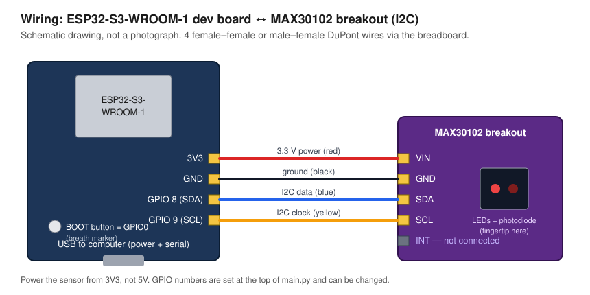

# Hardware

**Status: designed, not yet built or tested on a board by the repository authors.**
The MicroPython sensor driver is tested on the PC against a register-level
simulation of the MAX30102 (`tests/test_firmware.py`), which checks the
configuration bytes and FIFO decoding but not wiring, timing or the real I2C
bus. Nothing in this folder is a photograph of a working device. Work through
the bring-up checklist below and record what you observe.

Step-by-step instructions for Thonny (in Russian):
[docs/thonny_guide_ru.md](../docs/thonny_guide_ru.md).

## Bill of materials

| # | Part | Role | Notes |
|---|------|------|-------|
| 1 | ESP32-S3-WROOM-1 development board | Controller, USB serial link | Exact board model not yet recorded (e.g. DevKitC-1 or a clone); pin labels differ between boards |
| 2 | MAX30102 breakout module | PPG sensor (red 660 nm + IR 880 nm LEDs, photodiode, 18-bit ADC, I2C) | Exact breakout variant not yet recorded |
| 3 | Solderless breadboard | Mechanical support | |
| 4 | DuPont jumper wires ×4 | Power and I2C | Keep them short (≤ 20 cm) for 400 kHz I2C |
| 5 | USB data cable | Power and data to the computer | Charge-only cables do not work |

No extra respiratory sensor is used: that is the point of the project. The
independent breathing reference comes from a person pressing the board's BOOT
button once per breath (see `docs/experiment_protocol.md`).

## Wiring



| MAX30102 pin | ESP32-S3 pin | Wire |
|--------------|--------------|------|
| VIN          | 3V3          | red |
| GND          | GND          | black |
| SDA          | GPIO 8       | blue |
| SCL          | GPIO 9       | yellow |
| INT          | not connected | — |

The ESP32-S3 can route I2C to almost any GPIO: if you use other pins, change
`PIN_SDA` / `PIN_SCL` at the top of `main.py` and `check_sensor.py`.

Things to check on your particular parts (they vary between sellers):

- **Supply voltage.** The MAX30102 chip itself needs 1.8 V logic and 3.3 V LED
  supplies; breakouts carry regulators so that one VIN pin is enough. Use the
  ESP32's **3V3** pin. Do not use 5 V: the ESP32-S3's GPIOs are not 5 V tolerant
  and on some breakouts the I2C pull-ups are tied to VIN.
- **Pull-ups.** Most breakouts include I2C pull-up resistors. If the sensor is
  not found, measure SDA/SCL at idle: they should sit near 3.3 V. Some
  low-cost boards pull up to 1.8 V only, which is marginal for a 3.3 V host.
- **Red/IR order.** On some MAX30102 modules the two LED channels come out
  swapped relative to the library's naming. It does not matter for this
  project as long as you always analyse the same column; pick the one with the
  larger pulsatile component (`--channel ir` or `--channel red`).

## Firmware

### MicroPython (primary, for Thonny): `firmware/micropython/`

| File | Purpose |
|------|---------|
| `max30102.py` | Sensor driver, no external libraries: reset, configuration, FIFO read-out with loss counting |
| `main.py` | Runs at power-up; streams raw samples and breath markers over USB serial |
| `check_sensor.py` | Bring-up test: I2C scan, part ID, measured sample rate, signal level |
| `plot_pulse.py` | Live pulse wave for Thonny's Plotter (viewing only) |

| Item | Value |
|------|-------|
| Runtime | MicroPython for ESP32-S3 (generic "ESP32_GENERIC_S3" build), installed from Thonny |
| Libraries | None beyond MicroPython's built-in `machine` and `time` |
| Output rate | 100 samples/s (400 sps internal ÷ 4 on-chip averaging) |
| Resolution | 18 bit (411 µs LED pulse), ADC full scale 4096 nA |
| LED current | register 0x1F ≈ 6 mA; `LED_CURRENT` in `main.py` |
| FIFO | Roll-over disabled, so dropped samples are counted by the chip and reported |

Register values written by `MAX30102.setup()`:

| Register | Value | Meaning |
|----------|-------|---------|
| 0x09 MODE_CONFIG | 0x40, then 0x03 | Soft reset, then SpO2 mode (red + IR) |
| 0x08 FIFO_CONFIG | 0x40 | 4-sample averaging, roll-over off |
| 0x0A SPO2_CONFIG | 0x2F | ADC range 4096 nA, 400 sps, 411 µs / 18 bit |
| 0x0C, 0x0D LED PA | 0x1F | Red and IR LED current |

Main functions:

| Function | Purpose |
|----------|---------|
| `MAX30102.is_connected()` | True if the part ID register reads 0x15; never raises when the bus is dead |
| `MAX30102.setup()` | Resets and configures the sensor (table above) |
| `MAX30102.read_fifo()` | Returns the waiting samples and the number the chip had to drop |
| `MAX30102.ir()` / `.red()` | Decode one 18-bit value from the FIFO bytes |
| `run()` in `main.py` | Main loop: (re)initialise sensor, poll button, drain FIFO, print lines, recover from faults |

### Arduino (alternative): `firmware/arduino_alternative/`

The same data stream implemented as an Arduino sketch, for anyone who prefers
the Arduino IDE (core "esp32 by Espressif Systems", board "ESP32S3 Dev
Module", library "SparkFun MAX3010x Pulse and Proximity Sensor Library"). Its
calls were checked against the library header; it has not been compiled. Use
one firmware or the other, not both.

### Data stream

```
# ppg_streamer-micropython 1.0 | ESP32-S3 + MAX30102
# fs_nominal_hz=100 led_current_reg=0x1F
sample_index,device_us,ir,red,marker
0,20114,118211,95310,0
1,20114,118205,95301,0
```

- `sample_index` is the time base: `t = sample_index / fs`. Samples lost in the
  sensor FIFO are added to the index, so a loss appears as a gap, never as a
  hidden time shift.
- `device_us` is the microcontroller's clock at transmission. The host uses
  only its overall slope against `sample_index` to **measure the actual
  sampling rate**: the sensor runs from its own untrimmed oscillator, and a
  rate error of x % would become an x % error in every breathing rate.
- `marker` is 1 on the first sample after a button press.
- Lines beginning with `#` are status, warnings (`# WARN fifo_overflow …`) and
  errors (`# ERROR MAX30102 not found …`). The recorder stores them in the
  recording's `.meta.json`.

All signal processing is done in Python on the host, so every intermediate
step can be inspected and re-run on stored raw data. The microcontroller only
has to deliver unmodified samples with a trustworthy time base.

## Bring-up checklist

1. Wire as above; connect USB. The board's power LED should light.
2. Install MicroPython from Thonny and upload `max30102.py`, `check_sensor.py`
   and `plot_pulse.py`.
3. Run `check_sensor.py`. Expected: device `0x57` found, part ID correct,
   about 100 samples per second, no lost samples. If nothing is found, recheck
   wiring and supply.
4. Without a finger the IR level is low; with a fingertip resting lightly on
   the sensor it rises to tens of thousands of counts or more. If it sits at
   262143 the ADC is saturated: lower `LED_CURRENT`. If the pulse ripple in
   `plot_pulse.py` is only a few counts, raise it.
5. Upload `main.py`, reset the board, and check that pressing BOOT produces
   one line with `marker` = 1.
6. Close Thonny, then run
   `python scripts/record_serial.py --port <port> --duration 60 --analyze`
   and confirm that the reported sampling rate is close to 100 Hz and that the
   heart rate matches a manual pulse count.
7. Photograph the assembled device and add the pictures to `photos/`.

## Photos

`photos/` is intentionally empty until the device exists. See
`photos/README.md` for the shots to take.

## 3D models

Not applicable. The prototype is a bare sensor module on a breadboard and no
custom mechanical part was designed, so there are no CAD or STL files and
none are fabricated for show. If motion artifacts turn out to dominate the
error (see `docs/limitations.md`), a printed fingertip cradle that fixes the
contact pressure would be the first mechanical addition, and its CAD sources
would then belong in `hardware/3d_models/`.
