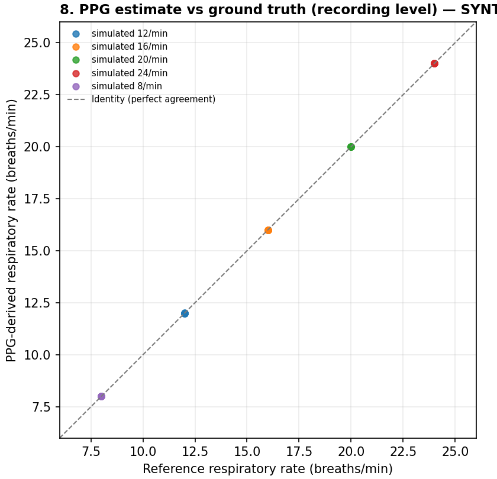
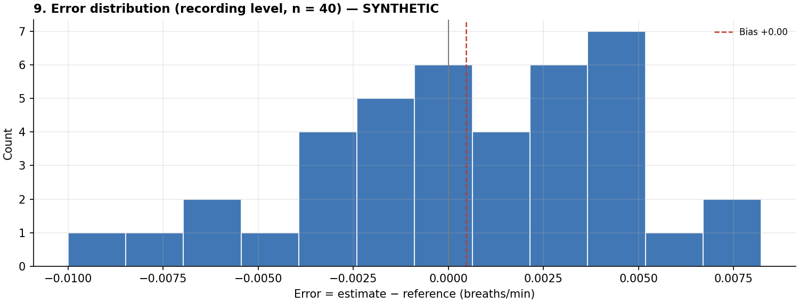
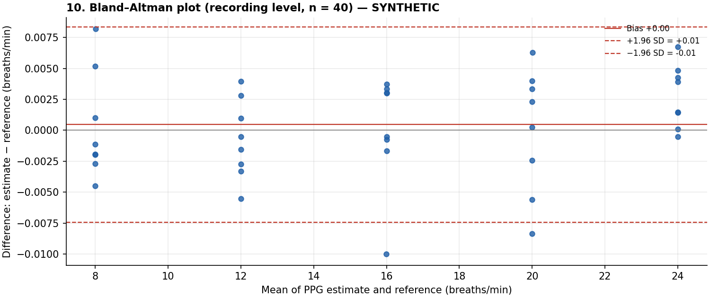

# Synthetic verification - agreement with the simulated breathing rate

> **SYNTHETIC DATA.** Every signal in this report was generated by `ppg_resp.synthetic`. The results verify the software against a known model. They are **not** a validation of the method on people and must not be quoted as its accuracy.

Error = estimate - reference, in breaths/min.

## Data and coverage

- Participants: 8, recordings: 40, windows: 440
- Windows with a reference rate: 440
- Accepted by the quality gate: 440 (100.0 %)
- Window statuses: {'OK': 440}

## Recording level (unit of inference)

| n | MAE | RMSE | Bias | SD of error | Pearson r | Spearman rho |
|---|-----|------|------|-------------|-----------|--------------|
| 40 | 0.00 | 0.00 | 0.00 | 0.00 | 1.000 | 0.980 |

- 95 % CI of MAE (cluster bootstrap over participants): [0.00, 0.00]
- 95 % CI of bias (cluster bootstrap over participants): [-0.00, 0.00]

## Bland-Altman

- Recording level: bias 0.00 (95 % CI [-0.00, 0.00]), limits of agreement -0.01 to 0.01; slope of difference vs mean 0.000 (p = 0.207)
- Window level, repeated-measures limits (between + within participant variance): bias 0.00, limits -0.06 to 0.06 (SD within 0.03, between 0.00)

## Window level (descriptive only)

| Set | n | MAE | RMSE | Bias | SD of error | Pearson r | Spearman rho |
|-----|---|-----|------|------|-------------|-----------|--------------|
| Accepted windows | 440 | 0.02 | 0.03 | 0.00 | 0.03 | 1.000 | 0.980 |
| All candidates (gate ignored) | 440 | 0.02 | 0.03 | 0.00 | 0.03 | 1.000 | 0.980 |

## By condition (recording level)

| condition | n_recordings | mae | rmse | bias | sd_error |
|---|---|---|---|---|---|
| simulated 12/min | 8 | 0.00 | 0.00 | -0.00 | 0.00 |
| simulated 16/min | 8 | 0.00 | 0.00 | 0.00 | 0.00 |
| simulated 20/min | 8 | 0.00 | 0.00 | -0.00 | 0.01 |
| simulated 24/min | 8 | 0.00 | 0.00 | 0.00 | 0.00 |
| simulated 8/min | 8 | 0.00 | 0.00 | 0.00 | 0.00 |

## By participant

| participant_id | n_recordings | mae | bias |
|---|---|---|---|
| SIM00 | 5 | 0.00 | 0.00 |
| SIM01 | 5 | 0.00 | 0.00 |
| SIM02 | 5 | 0.00 | -0.00 |
| SIM03 | 5 | 0.00 | 0.00 |
| SIM04 | 5 | 0.00 | 0.00 |
| SIM05 | 5 | 0.00 | 0.00 |
| SIM06 | 5 | 0.00 | -0.00 |
| SIM07 | 5 | 0.00 | -0.00 |

## Notes

- Window-level statistics are descriptive: overlapping windows of one recording are not independent, so no p-values are given for them.
- Several recordings per participant: recording-level p-values ignore this clustering and are optimistic. Prefer the cluster-bootstrap intervals.
- A high correlation alone does not show that the two methods agree; judge agreement by MAE, bias and the limits of agreement.

## Figures

## Null experiment (no respiratory modulation simulated)

- Windows analysed: 264
- Wrongly accepted by the quality gate (SQI >= 70): 4.9 %
- Wrongly accepted and all four methods agreeing within 3 breaths/min: 1.9 %

A clean pulse with no breathing information can still produce a spectral peak by chance. The quality gate reduces such false estimates but does not eliminate them.

## Noise sweep (10 % amplitude modulation, rates 10 and 18 /min)

| noise SD (pulse heights) | windows | accepted % | MAE of accepted (breaths/min) | max error of accepted |
|---|---|---|---|---|
| 0.00 | 176 | 100.00 | 0.00 | 0.01 |
| 0.02 | 176 | 100.00 | 0.03 | 0.10 |
| 0.05 | 176 | 100.00 | 0.06 | 0.22 |
| 0.10 | 176 | 100.00 | 0.11 | 0.45 |
| 0.20 | 176 | 71.59 | 0.22 | 0.96 |
| 0.40 | 176 | 11.36 | 0.50 | 1.64 |
